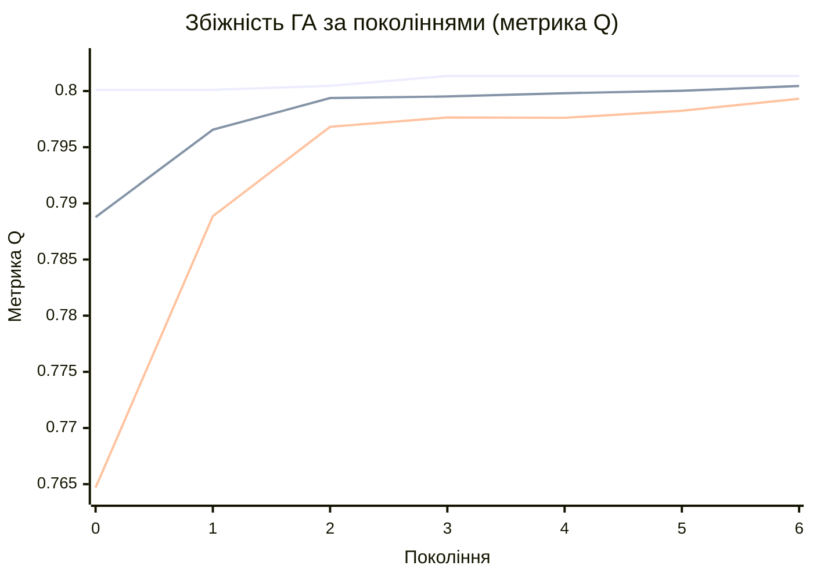

<div align="center">

**МІНІСТЕРСТВО ОСВІТИ І НАУКИ УКРАЇНИ**  
**КИЇВСЬКИЙ НАЦІОНАЛЬНИЙ УНІВЕРСИТЕТ імені Тараса Шевченка**  
**ФАКУЛЬТЕТ ІНФОРМАЦІЙНИХ ТЕХНОЛОГІЙ**  
*Кафедра програмних систем і технологій*

<br>

### Проєктна робота з дисципліни  
### «Алгоритми і оптимізація програмних рішень»

# «Розумний захищений архіватор файлів»  
**Робоча назва:** `SmartSecureArchiver` (репозиторій `Bychkov.arc`, команда `T01`, формат `SARC v1`, `seed = 2001`)

</div>

<div align="right">

**Виконали (базовий рівень усіх 4 зон):**  
Мітяй Максим Владиславович — розбір потоку, стиснення, WPF GUI  
Пуш Володимир Сергійович — аналіз файлу (MLP), пакування в томи (рюкзак 0/1)  
Залєвський Володимир Анатолійович — захист, оптимізація (ГА), модуль атаки  
Василик Володимир Сергійович — інтеграція, формат `SARC v1`, CLI, тестування

</div>

<div align="center">

Київ — 2026

</div>

---

## ЗМІСТ
1. [Постановка задачі](#1-постановка-задачі)
2. [Архітектура системи](#2-архітектура-системи)
3. [Алгоритми і структури даних](#3-алгоритми-і-структури-даних)
   * 3.1. [LZ77: пошук збігів і розбір потоку — Мітяй Максим](#31-lz77-пошук-збігів-і-розбір-потоку--мітяй-максим)
   * 3.2. [Канонічний Гаффман — Мітяй Максим](#32-канонічний-гаффман--мітяй-максим)
   * 3.3. [Пакування блоків по томах: рюкзак 0/1 — Пуш Володимир](#33-пакування-блоків-по-томах-рюкзак-01--пуш-володимир)
   * 3.4. [Аналіз файлу: ознаки, перцептрон, стратегія — Пуш Володимир](#34-аналіз-файлу-ознаки-перцептрон-стратегія--пуш-володимир)
   * 3.5. [Захист і формат `SARC v1` — Залєвський Володимир, Василик Володимир](#35-захист-і-формат-sarc-v1--залєвський-володимир-василик-володимир)
   * 3.6. [Генетичний алгоритм оптимізації та криптоаналіз — Залєвський Володимир](#36-генетичний-алгоритм-оптимізації-та-криптоаналіз--залєвський-володимир)
4. [Реалізація](#4-реалізація)
5. [Тестування](#5-тестування)
6. [Експериментальне дослідження](#6-експериментальне-дослідження)
   * 6.1. [Умови експериментів](#61-умови-експериментів)
   * 6.2. [Базова точка](#62-базова-точка)
7. [Результати: 5 обов’язкових таблиць](#7-результати-5-обовязкових-таблиць)
8. [Інші експерименти й аналіз](#8-інші-експерименти-й-аналіз)
   * 8.1. [Класифікатор типу файлу (MLP `52 → 64 → 7`)](#81-класифікатор-типу-файлу-mlp-52--64--7)
   * 8.2. [Вплив стратегії класифікатора та ефект автокореляції (`.pgm`)](#82-вплив-стратегії-класифікатора-та-ефект-автокореляції-pgm)
   * 8.3. [Модуль базової атаки й аудит цілісності (`Issue #38`)](#83-модуль-базової-атаки-й-аудит-цілісності-issue-38)
   * 8.4. [Узагальнений аналіз (ГА `min_match = 5`, ДП vs Greedy, еталон `team_config.json`)](#84-узагальнений-аналіз-га-min_match--5-дп-vs-greedy-еталон-team_configjson)
9. [Відомі обмеження](#9-відомі-обмеження)
10. [Висновки](#10-висновки)
11. [Внесок учасників](#11-внесок-учасників)
12. [Використані джерела](#12-використані-джерела)
13. [Додатки (відтворення результатів та кейси C1 / C2 / C5 / D1)](#13-додатки)

---

## 1. Постановка задачі

Метою проєкту є розроблення власного захищеного багатотомного архіватора (`SARC v1`, специфікація `FORMAT_SPEC_P2_2.md`). Програма отримує набір вхідних файлів і пароль, аналізує статистичні характеристики кожного файлу, стискає придатні для стиснення дані у блоки, оптимально розподіляє їх по томах обмеженого розміру (`max_volume_bytes = 65 536` Б) і захищає шифруванням та кодом автентичності. Розархіватор відновлює всі файли побайтово без втрат (`CRC32` і `orig_size`), або завершує роботу зі стандартизованим кодом помилки (`E_SHORT`, `E_MAGIC`, `E_LENGTH`, `E_HMAC`, `E_PAYLOAD`, `E_CODE`, `E_CRC`, `E_VOLUMES`, `E_CAPACITY`), не перезаписуючи наявні файли і не кидаючи необроблених винятків.

«Розумність» системи реалізується у двох незалежних контурах: багатошаровий перцептрон (MLP) визначає тип файлу `0..6` (пріоритет для рюкзака і стратегія `COMPRESS` / `NO_COMPRESSION`), а генетичний алгоритм (ГА) оптимізує параметри стиснення під метрику якості. Окремо реалізовано модуль атаки для тижня змагань (генетичний криптоаналіз слабких шифрів за частотами $n$-грам і перевірка цілісності формату `SARC v1`).

**Обмеження.** Алгоритми LZ77, канонічного кодування Гаффмана, вилучення ознак, MLP із зворотним поширенням помилки, ДП-рюкзака 0/1 і ГА написані власноруч з нуля на стандартній бібліотеці `.NET 8`. Зовнішні/криптографічні засоби стандартної бібліотеки використано лише для `PBKDF2`, `AES` (у режимі `ECB` без доповнення для власної побудови лічильника `CTR`), `HMAC-SHA256`, файлового вводу/виводу, JSON та тестування (`xUnit`).

**Критерій якості** (для всіх вимірювань у роботі використано параметри команди `T01` із [team/team_config.json](team/team_config.json)):

$$S = \frac{B_{\text{orig}}}{B_{\text{orig}} + B_{\text{arc}}}, \qquad T = \frac{t_{\text{ref}}}{t_{\text{ref}} + t}, \qquad Q = \alpha \cdot S + \beta \cdot T,$$

де $\alpha = 0.7$, $\beta = 0.3$, $t_{\text{ref}} = 30.0\text{ с}$, $B_{\text{orig}}$ — сумарний сирий розмір файлів, $B_{\text{arc}}$ — сумарний розмір усіх томів архіву із заголовками і HMAC, $t$ — сумарний час архівування та розпакування. Якщо хоча б один байт не відновлено точно, $Q = 0$.

---

## 2. Архітектура системи

Рух даних під час архівування (`ArchiveOrchestrator.CreateArchive`):

```mermaid
flowchart LR
    In["Вхідні файли + пароль"] --> FE["1. FeatureExtractor (52 ознаки)"]
    FE --> MLP["2. MlpClassifier (52-64-7) + стратегія"]
    MLP --> Split["Нарізання на блоки по 16 КБ + CRC32"]
    Split --> LZ["3. Lz77Parser (Greedy / Lazy) + Канонічний Гаффман"]
    LZ --> Fallback{"coded_len < raw_len?"}
    Fallback -- "Ні або NO_COMP" --> RawBlk["block_flags = 0x01 (NO_COMPRESSION)"]
    Fallback -- "Так" --> CmpBlk["block_flags = 0x00 (LIT, LEN, DIST + потік)"]
    RawBlk --> Cap["4. Резерв таблиці файлів і місткість W"]
    CmpBlk --> Cap
    Cap --> DP["ДП-рюкзак 0/1 (та Greedy для порівняння)"]
    DP --> Ser["5. Серіалізація Payload SARC v1 (Big-Endian)"]
    Ser --> KDF["PBKDF2-HMAC-SHA256 (1 раз на архів -> K_enc, K_mac)"]
    KDF --> Enc["6. AES-256-CTR (i=1..) + HMAC-SHA256"]
    Enc --> Out["Томи .arc (41B + Ciphertext + 32B)"]
```



Розпакування (`ArchiveOrchestrator.ExtractArchive`) працює строго у зворотному порядку за принципом **Fail-Closed**: перевіряються довжина тому $\ge 73$ Б (`E_SHORT`), `magic == "SARC"` і `version == 1` (`E_MAGIC`), точний розмір `41 + ciphertext_len + 32` (`E_LENGTH`), повнота та узгодженість індексів/солі томів (`E_VOLUMES`), далі одноразово виводяться ключі через `PBKDF2` і перевіряється `HMAC-SHA256` у постійний час (`FixedTimeEquals`) **до будь-якого розшифрування** (`E_HMAC`). Після розшифрування `AES-256-CTR` ($i = 1, 2, \dots$) валідуються `flags`, `reserved`, `file_type`, безпечні імена файлів (`FileNameValidator` $\to$ `E_PAYLOAD`), таблиці Гаффмана за рівністю Крафта й декодер LZ77 (`E_CODE`), безперервність `block_seq = 0, 1, ...` (`E_PAYLOAD`), `orig_size` та `CRC32` (`E_CRC`). Атомарний запис на диск через тимчасові файли `.tmp` стартує лише після повної верифікації всього архіву.

### Структура проєктів рішення `SmartSecureArchiver.sln`

| Проєкт / Модуль | Роль у системі | Зона відповідальності |
|---|---|---|
| `SmartSecureArchiver.Core` (`Analysis/`) | 52 статистичні ознаки, Z-нормалізація, MLP `52→64→7`, вибір стратегії | Пуш Володимир |
| `SmartSecureArchiver.Core` (`Compression/`) | `Lz77Parser` (Greedy / Lazy Greedy), канонічний Гаффман (`LIT`, `LEN`, `DIST`), `BitWriter`/`BitReader` | Мітяй Максим |
| `SmartSecureArchiver.Core` (`Packing/`) | `VolumeCapacityCalculator` (резерв $W$), `KnapsackPacker` (ДП 0/1 і жадібний) | Пуш Володимир |
| `SmartSecureArchiver.Core` (`Security/`) | `CryptoEngine` (`PBKDF2`, `AES-256-CTR`, `HMAC-SHA256`, `CRC32`), експерименти порядку операцій і цілісності | Залєвський Володимир |
| `SmartSecureArchiver.Core` (`Optimization/` і `Security/Attack/`) | `GeneticOptimizer` (3 гени, елітизм), `RandomSearch`, `WeakCipherGeneticAttacker` ($n$-грами) | Залєвський Володимир |
| `SmartSecureArchiver.Core` (`Format/`) | `VolumeHeader`, `SarcFormatHandler`, `FileNameValidator`, `ArchiveOrchestrator`, `QualityMetricCalculator`, `AblationStudyRunner` | Василик Володимир |
| `SmartSecureArchiver.Cli` | Консольна утиліта: `archive`, `extract`, `benchmark`, `ablation` | Василик Володимир |
| `SmartSecureArchiver.Gui` | Піксель-арт WPF GUI (`640×640`, 4x `NearestNeighbor`) із прив'язкою до `Core` | Мітяй Максим |
| `SmartSecureArchiver.Tests` | 131 модульний, крайовий, негативний, fuzz- та приймальний тест (`xUnit`) | Усі (інтеграція — Василик Володимир) |
| `tools/Training`, `Benchmarks`, `Zone3Runner` | Відтворення навчання MLP та експериментів Таблиць №2–№5 і атаки | Пуш В., Залєвський В., Василик В. |

Залежності спрямовані в один бік (`Cli`, `Gui`, `Tests` і `tools/*` залежать від `Core`, а `ArchiveOrchestrator` отримує аналізатор, компресор і пакувальник через чисті інтерфейси `IFeatureExtractor`, `IFileClassifier`, `IBlockCompressor`, `IKnapsackPacker` — див. ADR-01..ADR-05 у [DECISION.md](info%20-%20Folder/DECISION.md)).

---

## 3. Алгоритми і структури даних

Повні архітектурні обґрунтування наведено в [DECISION.md](info%20-%20Folder/DECISION.md) (`ADR-01`–`ADR-05`). Нижче описано кожен алгоритм у межах розв’язуваної задачі, його інваріанти, складність та спосіб перевірки.

### 3.1. LZ77: пошук збігів і розбір потоку — Мітяй Максим
* **Задача.** Замінити повторювані фрагменти блока (до `16 384` Б за замовчуванням) посиланнями `(distance, length)` у ковзному вікні до `32 768` Б (`MIN_MATCH = 3`, `MAX_MATCH = 258`).
* **Пошук збігів і структури даних.** Для кожної трійки байтів підтримується 15-бітна хеш-таблиця `head[32768]` і масив ланцюжків попередніх позицій `prev[n]`. Перевіряється не все вікно, а не більше `MaxChainChecks = 128` кандидатів у межах `pos - windowSize`, що дає передбачуваний час роботи замість квадратичного найгіршого випадку.
* **Два режими розбору (`Greedy` та `Lazy Greedy`):** у жадібному режимі на позиції `pos` береться найдовший знайдений збіг; у лінивому (`useLazyMatching = true`) додатково перевіряється `pos + 1` (за `bestLen < 258`), і якщо збіг із `pos + 1` довший (`nextLen > bestLen`), на `pos` видається літерал, а береться довший збіг із `pos + 1`:

```text
while pos < n:
    (bestDist, bestLen) <- FindBestMatch(pos, windowSize, minMatch, maxChecks=128)
    if bestLen >= minMatch:
        if useLazyMatching and pos + 1 < n and bestLen < 258:
            InsertHash(pos)
            (nextDist, nextLen) <- FindBestMatch(pos + 1, ...)
            if nextLen > bestLen:
                emit Literal(input[pos]); pos <- pos + 1
                emit Match(nextDist, nextLen); InsertHash(покриття)
                pos <- pos + nextLen; continue
        emit Match(bestDist, bestLen); InsertHash(покриття); pos <- pos + bestLen
    else:
        InsertHash(pos); emit Literal(input[pos]); pos <- pos + 1
```

* **Інваріант.** Декодування префікса токенів точно відтворює `input[0..pos-1]`, а для кожного посилання $1 \le \text{distance} \le \min(\text{pos}, W_{\text{lz}})$. При перекритті (`distance < length`) декодер копіює по одному байту.
* **Складність і перевірка.** Час $O(n \cdot C)$, де $n$ — довжина блока, $C \le 128$; пам'ять $O(2^{15} + n)$. Лінивий розбір виконує на 1 перевірку хеш-ланцюжка більше для позицій зі знайденим збігом. Коректність перевірено round-trip на 21 файлі корпусу, крайових файлах `0, 1, 2` байти (`< MIN_MATCH`) і 500 fuzz-тестах (`E_CODE`).

### 3.2. Канонічний Гаффман — Мітяй Максим
* **Задача.** Закодувати потік токенів після LZ77 трьома окремими деревами (`LIT` `0..256`, де `256` — маркер посилання; `LEN` `0..255` для `length - 3`; `DIST` `0..15` із додатковими молодшими бітами відстані), записуючи в блок лише довжини кодів (без структури дерева).
* **Ідея (ADR-03).** Дерево будується через власну купу мінімумів `MinHeap<HuffmanNode>`. Якщо максимальна глибина перевищує `MaxCodeLength = 15` біт, виконується двофазне обмеження довжини з цілочисельним балансуванням частот/глибин. Якщо закодований блок виявляється не меншим за сирий (`coded_len >= raw_len`), `BlockCompressor` автоматично перемикається на `NO_COMPRESSION` (`block_flags = 0x01`).
* **Інваріант (рівність Крафта).** Для кожного активного алфавіту при `nsym > 1` перевіряється точна цілочисельна рівність $\sum_{i=1}^{\text{nsym}} 2^{15 - L_i} = 32768$; при `nsym == 1` (вироджений алфавіт) єдиний символ отримує `length = 1, code = 0`. Будь-яке порушення при читанні повертає `E_CODE`.
* **Складність і перевірка.** Побудова канонічних кодів $O(k \log k)$, де $k \le 257$ — розмір алфавіту; кодування/декодування лінійне за кількістю токенів $O(T)$. Перевірено на контрольному прикладі `ref_01_single_file.arc`, виродженому рядку `AAAAAAA` і пошкоджених таблицях Гаффмана (`E_CODE`).

### 3.3. Пакування блоків по томах: рюкзак 0/1 — Пуш Володимир
* **Задача.** Набрати у черговий том множину ще не розміщених блоків-кандидатів з максимальною сумарною цінністю (пріоритет типу файлу з `team_config.json`: `3` для тексту/коду, `2` для CSV/PGM/BIN, `1` для стиснутого/штучного) без перевищення чистої місткості $W$.
* **Постановка та інваріант місткості (ADR-05).** До запуску рюкзака фіксуються всі файли, яким належить хоча б один ще не розміщений блок, і резервується вся їхня таблиця файлів:
  $$W = \text{max\_volume\_bytes} - 41 - 32 - 6 - \text{file\_table\_size}, \qquad w_i = \text{coded\_len}_i + 15.$$
  Склад таблиці файлів після вибору рюкзака не змінюється. Якщо навіть таблиця файлів чи один блок $> W$, повертається `E_CAPACITY`.

```text
previous[0..W] <- 0
for i = 0 .. n-1:
    if weight[i] > W: continue
    allocate bitset decisions[i] розміру ceil((W+1)/64)
    for w = 0 .. W:
        if w >= weight[i] and previous[w - weight[i]] + value[i] > previous[w]:
            current[w] <- previous[w - weight[i]] + value[i]
            setBit(decisions[i], w)
        else:
            current[w] <- previous[w]
    swap(previous, current)
rem <- W; walk i = n-1 .. 0: if bit(decisions[i], rem) -> select[i]=true; rem -= weight[i]
```

* **Складність і перевірка.** Точний ДП 0/1: $O(n \cdot W)$ за часом та $O(W + n \cdot W / 64)$ байтів за пам’яттю завдяки бітовій матриці рішень `decisions` (запобігає повторному включенню одного блока); жадібний алгоритм за спаданням $v_i / w_i$: $O(n \log n)$. Коректність перевірена контрприкладом `(w=6, v=6), (w=5, v=5), (w=5, v=5)` при `W=10` (жадібний бере 6, ДП — 10) та 300 випадковими наборами (`Knapsack_DpVsGreedy_DpValueIsNeverLess`).

### 3.4. Аналіз файлу: ознаки, перцептрон, стратегія — Пуш Володимир
* **Задача.** Визначити тип файлу `0..6` і прийняти рішення `COMPRESS` або `NO_COMPRESSION`.
* **Ознаки (`FeatureExtractor`).** За $O(N)$ (де $N$ — довжина файлу, із використанням `ArrayPool<int>` для таблиці 65 536 біграм) обчислюється вектор із **52 ознак**: байтова ентропія Шеннона (1), нормована 32-кошикова гістограма байтів (32), частка друкованих ASCII (1), середня відстань між `\n` (1), автокореляція Пірсона на лагах `1..16` (16), ентропія біграм (1).
* **Перцептрон `52 → 64 → 7` (`MlpNetwork`, `MlpTrainer`).** Реалізовано з нуля: Z-стандартизація ознак на `train/`, прихований шар `ReLU` (ініціалізація He), вихідний `Softmax` (ініціалізація Xavier), функція втрат Cross-Entropy, міні-пакетний SGD (`batch_size = 32`, `epochs = 250`, `lr = 0.1`, `decay = 0.99`). Модель навчається на `train/` (350 файлів) з трьох ініціалізацій (`seed = 2026, 2027, 2028`), найкраща відбирається за `macro-F1` на `valid/` (105 файлів).
* **Складність.** Інференс одного файлу потребує $52 \cdot 64 + 64 \cdot 7 = 3\,776$ множень; навчання $O(E \cdot N_{\text{samples}} \cdot P)$, де $E=250$, $P$ — кількість ваг.
* **Стратегія (`MlpClassifier.ShouldCompress`).** Стиснення вимикається, якщо `fileClass == 5` («вже стиснуте»). Якщо ж `Entropy >= threshold` (`7.95` за замовчуванням), стиснення відхиляється **лише коли немає сильної локальної автокореляції** (`max |AC_{1..16}| < 0.5`). Це правило враховує п. 10.28 Методички: растрові дані `.pgm` при високій ентропії (~`7.98`) мають автокореляцію `~0.95` і добре стискаються LZ77, тоді як випадковий шум має `max |AC| ~ 0.02` і коректно пропускається.

### 3.5. Захист і формат `SARC v1` — Залєвський Володимир, Василик Володимир
* **KDF (`PBKDF2-HMAC-SHA256`).** `100 000` ітерацій, випадкова 16-байтова сіль (`salt`, спільна для всіх томів одного архіву), виконується **один раз на архів** (ADR-04) $\to$ `64` байти, які розбиваються на два незалежні ключі: $K_{\text{enc}}$ (`32` Б) та $K_{\text{mac}}$ (`32` Б). Пароль і проміжний буфер очищуються `ZeroMemory`.
* **Шифрування (`AES-256-CTR`).** Кожен том має унікальний 12-байтний `nonce = 8B prefix || uint32_BE(volume_index)`, а 16-байтний блок лічильника формується як `nonce || uint32_BE(i)` з нумерацією `i = 1, 2, ...`.
* **Автентифікація (Encrypt-then-MAC) та безпека імен.** `HMAC-SHA256` ключем $K_{\text{mac}}$ рахується над `[VolumeHeader (41B) || Ciphertext]` і перевіряється через `FixedTimeEquals` строго до розшифрування. `SarcFormatHandler` читає й пише всі `uint16`/`uint32` у Big-Endian через `BinaryPrimitives` (`ADR-02`), а `FileNameValidator` відхиляє шляхи, `..`, `/`, `\`, `:`, `\0` кодом `E_PAYLOAD` до запису на диск.

### 3.6. Генетичний алгоритм оптимізації та криптоаналіз — Залєвський Володимир
* **Хромосома оптимізації параметрів (3 гени):** `window_size` $\in [1024, 32768]$ (крок `256`), `min_match` $\in [3, 12]$, `no_comp_threshold` $\in [6.0, 8.0]$ (крок `0.01`).
* **Оператори:** турнірний відбір (`tournamentSize = 3`), одноточковий кросовер (`crossoverRate = 0.8`), випадкова мутація (`mutationRate = 0.25`), елітизм (`elitismCount = max(1, pop / 4)` $\to$ 2 еліти при `pop = 10`, що структурно гарантує $\text{best\_final} \ge \text{best\_initial}$). Функція пристосованості — повний round-trip прогін $Q$ із кешуванням за ключем хромосоми.
* **Складність.** $O(G \cdot P \cdot F)$, де $G$ — покоління (`6`), $P$ — популяція (`10`), $F$ — вартість одного прогону `ArchiveOrchestrator` з `PBKDF2`. Для порівняння `RunRandomSearchWithLog` отримує рівно стільки ж оцінок `Q` (`58`).
* **Атака на слабкі шифри (`WeakCipherGeneticAttacker`).** Використовує ГА для підбору ключів до шифрів Віженера (EN/UA), підстановки та короткого XOR за статистичними профілями 1-грам і біграм (`NgramFrequencyScorer`).

---

## 4. Реалізація

* **Строгий парсер `SARC v1`:** уся бінарна структура (41-байтовий відкритий заголовок, таблиця файлів, 15-байтові записи таблиці блоків і 32-байтовий тег HMAC) серіалізується строго без вирівнювань у Big-Endian; будь-яке порушення повертає контрольований код `SarcErrorCode` без аварійного падіння.
* **Безпека та атомарність розпакування:** імена файлів валідуються як недовірені дані до відкриття потоків; розпаковані файли спочатку проходять перевірку `orig_size` та `CRC32`, після чого атомарно переносяться через `.tmp`-файли без псування вже наявних файлів у разі збою.
* **Вбудована модель та інтерфейси:** ваги навченого MLP (`models/mlp_weights.bin`) вбудовані в `SmartSecureArchiver.Core` як `EmbeddedResource`, тому клієнти (`Cli`, `Gui`) і тести не залежать від локальних шляхів до файлу ваг. Для WPF GUI у `.csproj` додано `<RollForward>LatestMajor</RollForward>` (підтверджено в `runtimeconfig.json`) для сумісності з новішим `.NET Desktop Runtime`.
* **Усунені дефекти під час фінального аудиту перед здачею:**
  1. У [.gitattributes](.gitattributes) додано `team/** -text`, а `team/` відновлено з `HEAD` у точні `LF`-байти (`team/corpus/`: `329 903` Б замість `335 122` Б із `CRLF` на Windows), після чого модель MLP перенавчено (`valid macro-F1 = 0.9706`).
  2. У [MlpClassifier.cs](src/SmartSecureArchiver.Core/Analysis/Perceptron/MlpClassifier.cs) усунено помилковий пропуск стиснення високоентропійних `.pgm`-растрів (додано перевірку `max |AC| >= 0.5` за п. 10.28 Методички — базовий архів зменшився зі `167 151` Б до `131 185` Б).
  3. У [Program.cs](src/SmartSecureArchiver.Cli/Program.cs) виключено службовий `labels.csv` при запуску `benchmark` і додано підкоманду `ablation`; реалізовано [AblationStudyRunner.cs](src/SmartSecureArchiver.Core/Format/AblationStudyRunner.cs) та збереження Таблиць №2 і №3 у `Benchmarks`.
  4. У [FormatContractTests.cs](tests/SmartSecureArchiver.Tests/Format/FormatContractTests.cs) видалено заглушку `ControlExampleBlockCompressorStub` і переведено всі перевірки (`ref_01`..`ref_06`, `bad_01`..`bad_06`, крайні випадки C2) на реальний `ArchiveOrchestrator`; у [Lz77BenchmarkTests.cs](tests/SmartSecureArchiver.Tests/Compression/Lz77BenchmarkTests.cs) виправлено підрахунок сирого розміру та формулювання швидкодії.
  5. У [ci.yml](.github/workflows/ci.yml) увімкнено `-warnaserror` та збір Cobertura-покриття (`--collect:"Code Coverage;Format=cobertura"`).

---

## 5. Тестування

Стратегія: **модульні тести $\to$ крайові випадки (C2) $\to$ негативні та fuzz-тести (C5) $\to$ інтеграційні тести повного тракту $\to$ приймальні тести на еталонах та корпусі (C1, D1)**. CI (`.github/workflows/ci.yml` на `ubuntu-latest`) збирає рішення з `-warnaserror`, виконує тести та вивантажує Cobertura-звіт покриття.

| Що перевіряється | Еталон або спосіб перевірки |
|---|---|
| LZ77 + Гаффман | Round-trip по 21 файлу корпусу (`Greedy`, `Lazy`, `NoCompression`, блоки 16 КБ), контроль `CRC32` |
| Канонічний Гаффман | Контрольний приклад `ref_01_single_file.arc`, рівність Крафта ($\sum 2^{15-L_i}=32768$), вироджений алфавіт (`AAAAAAA`), пошкоджені потоки (500 fuzz-мутацій $\to$ `E_CODE`) |
| ДП-рюкзак | Порівняння з жадібним на 300 випадкових задачах (`DpValueIsNeverLess`), контрприклад `(6,6)/(5,5)/(5,5)` при `W=10`, перевірка `E_CAPACITY` |
| Криптографія | Незалежні `K_enc != K_mac`, лічильник `i = 1`, унікальні `nonce`, невірний пароль / підміна 1 байта в заголовку, шифротексті або HMAC $\to$ `E_HMAC` до decrypt |
| Формат `SARC v1` | Усі 6 валідних еталонів викладача (`ref_01`..`ref_06`, вкл. зворотний порядок томів `ref_06`) + усі 6 дефектних з `expected_failures.json` (`bad_01`..`bad_06`) |
| Крайові та безпекові кейси | Порожній архів, `0`/`1`/`2` Б, відсутній файл, 11 небезпечних імен (`../`, `\`, `/`, `:`, `\0` $\to$ `E_PAYLOAD`), атомарність відновлення через `.tmp` |
| Перцептрон | Інваріанти ознак (порожній файл, 0 і 8 біт ентропії, біграми), high-entropy автокорельований растр (`MlpTests`), `valid macro-F1 = 0.9706`, детермінованість |
| ГА та модуль атаки | Рівний бюджет оцінок з Random Search, інваріант `D1 №17` (`best_final >= best_initial`), атаки на Віженера (EN/UA), підстановку і XOR + аудит підміни `ref_01` |

**Підсумок перевірки** *(конфігурація `Release`, виконано після всіх змін у коді C# та `.csproj`, до останніх текстових правок `ci.yml`, `README.md` і `META-USAGE.md`)*:
* Збірка з `-warnaserror`: **0 помилок, 0 попереджень**.
* Автотести: **131/131 пройдено** (`0` провалених, `0` пропущених).
* Покриття коду (`Code Coverage;Format=cobertura`): для ядра **`SmartSecureArchiver.Core`** — **84.90%** рядків і **83.19%** гілок; по рішенню в цілому — **89.23%** рядків (`5005 / 5609`) та **84.45%** гілок (`1586 / 1878`).

---

## 6. Експериментальне дослідження

### 6.1. Умови експериментів
| Параметр | Значення |
|---|---|
| Дані корпусу | `team/corpus/`: **21** файл (`329 903` Б, `LF`), 7 груп типів файлів `0..6` |
| Дані класифікатора | `team/train/`: **350** файлів (`50`/клас); `team/valid/`: **105** файлів (`15`/клас); `holdout/` прихована у викладача |
| Середовище | Windows, `.NET 8.0.14` SDK/Runtime, конфігурація **`Release`** (`SmartSecureArchiver.sln`) |
| Параметри $Q$ і пакування | Із `team/team_config.json`: $\alpha = 0.7$, $\beta = 0.3$, $t_{\text{ref}} = 30.0\text{ с}$, `max_volume_bytes = 65 536` Б, `block_size = 16 384` Б |
| Пріоритети рюкзака | Класи `0, 1` $\to$ `3`; класи `2, 3, 4` $\to$ `2`; класи `5, 6` $\to$ `1` |
| Seed | Командний `seed = 2001` (ГА / `RandomSearch`); MLP ініціалізації `2026, 2027, 2028` |
| Протокол повторів | Таблиці №1, №3: мінімум із 3 прогонів після прогріву JIT; Таблиця №2: прогрів JIT + медіана з 3 повних циклів `archive + extract` |

### 6.2. Базова точка
Повний базовий конвеєр (`MLP + Greedy LZ77 + Канонічний Гаффман + ДП-рюкзак 0/1 + PBKDF2 / AES-256-CTR / HMAC-SHA256`) на всьому корпусі з 21 файлу (`329 903` Б) при прогрітому JIT дає:
* **$B_{\text{arc}} = 131\,185\text{ Б}$**, $t = 0.2156\text{ с}$ (медіана з 3 повних прогонів `archive + extract + звірка байтів`);
* **$S = 0.7155$**, **$T = 0.9929$**, підсумкова метрика **$Q = 0.7987$** (усі файли відновлено побайтово).
*(На холодному старті CLI `benchmark` з першим JIT-компілюванням: $t = 3.1780\text{ с}$, $T = 0.9042$, $Q = 0.7721$ при тому ж $B_{\text{arc}} = 131\,185\text{ Б}$.)*

---

## 7. Результати: 5 обов’язкових таблиць

### Таблиця №1. Розбір потоку: Greedy LZ77 проти Lazy Greedy LZ77
**Питання.** Скільки заощаджує лінивий розбір (`Lazy Greedy LZ77`) порівняно з жадібним (`Greedy LZ77`) на 7 групах корпусу і якою ціною за часом?  
**Умови.** Ті самі файли `team/corpus/` (`329 903` Б), `window_size = 32 768`, `MIN_MATCH = 3`, `MAX_MATCH = 258`, канонічний Гаффман; змінюється лише режим розбору (`Lz77BenchmarkTests`, [BENCHMARK_ZONE1.md](docs/BENCHMARK_ZONE1.md)).

| Група файлів | К-сть | Було, Б | Greedy, Б (коеф.) | Lazy Greedy, Б (коеф.) | Різниця (Lazy − Greedy) | Час Greedy, мс | Час Lazy, мс |
|---|---:|---:|---:|---:|---:|---:|---:|
| 0 — Природний текст | 3 | 46 471 | 8 544 (5.44x) | 8 467 (5.49x) | **-77 Б** | 8.05 | 10.71 |
| 1 — Вихідний код | 3 | 68 803 | 15 861 (4.34x) | 15 111 (4.55x) | **-750 Б** | 8.77 | 10.56 |
| 2 — Структуровані дані | 3 | 57 452 | 22 989 (2.50x) | 21 885 (2.63x) | **-1104 Б** | 9.03 | 10.48 |
| 3 — Растр без стиснення | 3 | 51 109 | 5 291 (9.66x) | 5 291 (9.66x) | **0 Б** | 3.37 | 3.54 |
| 4 — Виконуваний файл | 3 | 32 768 | 16 333 (2.01x) | 16 300 (2.01x) | **-33 Б** | 7.23 | 9.03 |
| 5 — Вже стиснуте | 3 | 34 789 | 34 789 (1.00x) | 34 789 (1.00x) | **0 Б** | 7.09 | 6.76 |
| 6 — Штучні дані | 3 | 38 511 | 20 840 (1.85x) | 20 840 (1.85x) | **0 Б** | 3.80 | 3.99 |
| **УСЬОГО ПО КОРПУСУ** | **21** | **329 903** | **124 647 (2.65x)** | **122 683 (2.69x)** | **-1964 Б** | **47.33** | **55.09** |

<details>
<summary>Деталізація Таблиці №1 по всіх 21 файлах корпусу</summary>

| Група файлів | Файл | Сирий, Б | Greedy (час / Б / коеф.) | Lazy Greedy (час / Б / коеф.) | Висновок |
|---|---|---:|---|---|---|
| 0 — Природний текст | `f0000.txt` | 5508 | 0.96 мс / **1170** Б (4.71x) | 1.38 мс / **1166** Б (4.72x) | Lazy кращий на 4 Б (-0.34%), у 1.43x повільніше |
| 0 — Природний текст | `f0007.txt` | 23201 | 3.28 мс / **4762** Б (4.87x) | 3.99 мс / **4706** Б (4.93x) | Lazy кращий на 56 Б (-1.18%), у 1.21x повільніше |
| 0 — Природний текст | `f0014.txt` | 17762 | 3.80 мс / **2612** Б (6.80x) | 5.35 мс / **2595** Б (6.84x) | Lazy кращий на 17 Б (-0.65%), у 1.41x повільніше |
| 1 — Вихідний код | `f0001.py` | 24195 | 3.21 мс / **5509** Б (4.39x) | 4.01 мс / **5254** Б (4.61x) | Lazy кращий на 255 Б (-4.63%), у 1.25x повільніше |
| 1 — Вихідний код | `f0008.py` | 24028 | 3.03 мс / **5539** Б (4.34x) | 3.38 мс / **5271** Б (4.56x) | Lazy кращий на 268 Б (-4.84%), у 1.12x повільніше |
| 1 — Вихідний код | `f0015.py` | 20580 | 2.54 мс / **4813** Б (4.28x) | 3.17 мс / **4586** Б (4.49x) | Lazy кращий на 227 Б (-4.72%), у 1.25x повільніше |
| 2 — Структуровані дані | `f0002.csv` | 22461 | 3.45 мс / **9007** Б (2.49x) | 4.07 мс / **8533** Б (2.63x) | Lazy кращий на 474 Б (-5.26%), у 1.18x повільніше |
| 2 — Структуровані дані | `f0009.csv` | 12528 | 1.95 мс / **5037** Б (2.49x) | 2.27 мс / **4790** Б (2.62x) | Lazy кращий на 247 Б (-4.90%), у 1.17x повільніше |
| 2 — Структуровані дані | `f0016.csv` | 22463 | 3.63 мс / **8945** Б (2.51x) | 4.14 мс / **8562** Б (2.62x) | Lazy кращий на 383 Б (-4.28%), у 1.14x повільніше |
| 3 — Растр без стиснення | `f0003.pgm` | 24208 | 1.35 мс / **1909** Б (12.68x) | 1.33 мс / **1909** Б (12.68x) | 0 Б різниці; Lazy швидший |
| 3 — Растр без стиснення | `f0010.pgm` | 9737 | 0.92 мс / **1619** Б (6.01x) | 0.94 мс / **1619** Б (6.01x) | 0 Б різниці; Greedy швидший |
| 3 — Растр без стиснення | `f0017.pgm` | 17164 | 1.10 мс / **1763** Б (9.74x) | 1.27 мс / **1763** Б (9.74x) | 0 Б різниці; Greedy швидший |
| 4 — Виконуваний файл | `f0004.bin` | 5135 | 1.57 мс / **3058** Б (1.68x) | 1.85 мс / **3058** Б (1.68x) | 0 Б різниці; Greedy швидший |
| 4 — Виконуваний файл | `f0011.bin` | 7379 | 1.90 мс / **3964** Б (1.86x) | 2.22 мс / **3962** Б (1.86x) | Lazy кращий на 2 Б (-0.05%), у 1.17x повільніше |
| 4 — Виконуваний файл | `f0018.bin` | 20254 | 3.76 мс / **9311** Б (2.18x) | 4.96 мс / **9280** Б (2.18x) | Lazy кращий на 31 Б (-0.33%), у 1.32x повільніше |
| 5 — Вже стиснуте | `f0005.z` | 15152 | 2.93 мс / **15152** Б (1.00x) | 3.04 мс / **15152** Б (1.00x) | `NO_COMPRESSION` (0 Б) |
| 5 — Вже стиснуте | `f0012.z` | 10978 | 1.91 мс / **10978** Б (1.00x) | 1.99 мс / **10978** Б (1.00x) | `NO_COMPRESSION` (0 Б) |
| 5 — Вже стиснуте | `f0019.z` | 8659 | 2.25 мс / **8659** Б (1.00x) | 1.73 мс / **8659** Б (1.00x) | `NO_COMPRESSION` (0 Б) |
| 6 — Штучні дані | `f0006.dat` | 4635 | 0.19 мс / **49** Б (94.59x) | 0.20 мс / **49** Б (94.59x) | 0 Б різниці; Greedy швидший |
| 6 — Штучні дані | `f0013.dat` | 20716 | 3.36 мс / **20716** Б (1.00x) | 3.55 мс / **20716** Б (1.00x) | `NO_COMPRESSION` (0 Б) |
| 6 — Штучні дані | `f0020.dat` | 13160 | 0.25 мс / **75** Б (175.47x) | 0.24 мс / **75** Б (175.47x) | 0 Б різниці; Lazy швидший |

</details>

**Висновок до Таблиці №1.** `Lazy Greedy LZ77` дає найбільший виграш на структурованих CSV-файлах (`-1 104` Б, до `-5.26%`) і вихідному коді (`-750` Б, до `-4.84%`), де збіги перекриваються, скорочуючи загальний розмір блоків на `1 964` Б (`-1.58%`) ціною `~16%` додаткового часу (`55.09` мс проти `47.33` мс). На растрі (`.pgm`), вже стиснених (`.z`) і випадковому шумі (`f0013.dat`) різниця дорівнює `0` Б. У інтерактивній конфігурації за замовчуванням (`CreateArchive`) залишено `Greedy`, а `Lazy` додано до конфігурацій Таблиці №2.

---

### Таблиця №2. Вплив кожного реалізованого блока на метрику $Q$ (Ablation Study)
**Питання.** Який блок дає вирішальний внесок у метрику $Q$, а який оптимізує чи обмежує систему без втрати коректності?  
**Умови.** Повний корпус (`21` файл, `329 903` Б), усі конфігурації проходять повний захищений цикл (`archive + extract + перевірка байтів`, `AES-256-CTR + HMAC-SHA256`), медіана 3 запусків після прогріву JIT ([table2_ablation.md](reports/table2_ablation.md)). Канонічний Гаффман окремо без LZ77 протестовано в рядку «Без пошуку повторів LZ77».

| Конфігурація системи | Змінений / вимкнений блок | $B_{\text{arc}}$, Б | Час $t$, с | $S$ | $T$ | $Q$ | $\Delta Q$ | Побайтово |
|---|---|---:|---:|---:|---:|---:|---:|:---:|
| Повна базова система (MLP + Greedy LZ77 + Гаффман + ДП-рюкзак + AES/HMAC) | — (еталонний базовий конвеєр) | 131 185 | 0.2156 | 0.7155 | 0.9929 | **0.7987** | 0.0000 | OK |
| Без ML-класифікатора (MLP вимкнено) | Блок 1: FeatureExtractor + MlpClassifier | 131 185 | 0.1900 | 0.7155 | 0.9937 | **0.7990** | +0.0003 | OK |
| Без пошуку повторів LZ77 (тільки Канонічний Гаффман) | Блок 2: Lz77Parser (тільки літерали) | 229 300 | 0.1699 | 0.5900 | 0.9944 | **0.7113** | -0.0874 | OK |
| Без стиснення (`NO_COMPRESSION`, без LZ77 і Гаффмана) | Блоки 2+3: LZ77 + Канонічний Гаффман | 332 252 | 0.2248 | 0.4982 | 0.9926 | **0.6465** | -0.1522 | OK |
| Без ДП-рюкзака (послідовне пакування томів) | Блок 4: KnapsackPacker (вимкнено) | 131 228 | 0.1517 | 0.7154 | 0.9950 | **0.7993** | +0.0006 | OK |
| Жадібне пакування ($v/w$) замість ДП-рюкзака 0/1 | Блок 4: заміна DP 0/1 на Greedy $v/w$ | 131 187 | 0.1693 | 0.7155 | 0.9944 | **0.7992** | +0.0005 | OK |
| Повна система із Lazy Greedy LZ77 | Блок 2: режим Lazy Greedy LZ77 | 129 069 | 0.1927 | 0.7188 | 0.9936 | **0.8012** | +0.0025 | OK |
| Повна система з параметрами ГА `[28416, 5, 6.46]` | Блок 6: GeneticOptimizer | 129 231 | 0.1694 | 0.7185 | 0.9944 | **0.8013** | +0.0026 | OK |

**Висновок до Таблиці №2.** Вирішальний внесок дає тракт стиснення `LZ77 + Гаффман`: без нього $B_{\text{arc}}$ виростає до `332 252` Б, а $Q$ падає на **`-0.1522`**; левову частку (`-0.0874`) забезпечує `LZ77`. Варіант без MLP дає ті самі `131 185` Б через вбудований у `BlockCompressor` захисний перехід у `NO_COMPRESSION` при `coded_len >= raw_len` (детальніше — у розд. 8.2). Підключення `Lazy Greedy LZ77` або параметрів ГА підіймає $Q$ вище `0.801`.

---

### Таблиця №3. ДП-рюкзак 0/1 проти жадібного алгоритму (перший том)
**Питання.** Чи дає точний алгоритм ДП 0/1 більшу цінність у першому томі порівняно з жадібним алгоритмом за $v/w$ і яка різниця за часом?  
**Умови.** Перший том обмеженням `65 536` Б, таблиця всіх файлів-кандидатів `432` Б, чиста місткість $W = 65\,025$ Б, кандидатів: `32` блоки ([table3_knapsack.md](reports/table3_knapsack.md)).

| Показник | ДП 0/1 ($O(n \cdot W)$) | Жадібний $v/w$ ($O(n \log n)$) |
|---|---:|---:|
| Сумарна цінність | 60 | 60 |
| Сумарна вага, байт | 64 782 | 64 782 |
| Кількість блоків | 26 | 26 |
| Час, мс (мінімум із 3 прогонів) | 4.053 | 0.011 |
| Різниця цінності ($\text{ДП} - \text{greedy}$) | 0 | — |
| Різниця ваги ($\text{ДП} - \text{greedy}$), байт | 0 | — |

**Висновок до Таблиці №3.** На 32 блоках корпусу обидва методи набрали ідентичну сумарну цінність `60` (`64 782` Б з `65 025` Б, `26` блоків), причому ДП витратив `4.053` мс проти `0.011` мс у жадібного. Причина нульового виграшу — дискретна шкала пріоритетів `{1, 2, 3}` та дрібні розміри стиснених блоків відносно $W$ (решта `243` Б менша за будь-який із 6 решти блоків). Перевагу ДП доведено на контрприкладі `(6,6)/(5,5)/(5,5)` і 300 випадкових задачах; по всьому багатотомному архіву (Таблиця №2) ДП зменшив розмір на `43` Б порівняно з послідовним пакуванням.

---

### Таблиця №4. Порядок операцій: «Стиснути $\to$ Шифрувати» проти «Шифрувати $\to$ Стиснути»
**Питання.** Наскільки деградує стиснення, якщо дані зашифрувати до стиснення?  
**Гіпотеза.** Вихідний потік `AES-256-CTR` статистично невідрізнимий від випадкового шуму ($\approx 8$ біт/байт), тому стиснення після шифрування впаде до `1.000x`.  
**Умови.** Повний корпус (`21` файл, `329 903` Б), `AES-256-CTR` + `BlockCompressor`, round-trip перевірено побайтово ([table4_encrypt_vs_compress.md](reports/table4_encrypt_vs_compress.md)).

| Схема обробки | Сумарний розмір блоків, Б | Коефіцієнт стиснення | Round-trip |
|---|---:|---:|:---:|
| **Стиснути $\to$ Зашифрувати (`SARC v1`)** | **129 897** | **2.540x** | **OK** |
| Зашифрувати $\to$ Стиснути (антипатерн) | 329 903 | 1.000x | OK |

<details>
<summary>Деталізація Таблиці №4 по 21 файлу корпусу</summary>

| Файл | Прогноз типу | Сирий, Б | Стиснути $\to$ Шифрувати | Шифрувати $\to$ Стиснути | Round-trip |
|---|---:|---:|---:|---:|:---:|
| `f0000.txt` | 0 | 5508 | 1170 (4.71x) | 5508 (1.00x) | OK |
| `f0001.py` | 1 | 24195 | 6047 (4.00x) | 24195 (1.00x) | OK |
| `f0002.csv` | 2 | 22461 | 9046 (2.48x) | 22461 (1.00x) | OK |
| `f0003.pgm` | 3 | 24208 | 2962 (8.17x) | 24208 (1.00x) | OK |
| `f0004.bin` | 4 | 5135 | 3058 (1.68x) | 5135 (1.00x) | OK |
| `f0005.z` | 5 | 15152 | 15152 (1.00x) | 15152 (1.00x) | OK |
| `f0006.dat` | 6 | 4635 | 49 (94.59x) | 4635 (1.00x) | OK |
| `f0007.txt` | 0 | 23201 | 5295 (4.38x) | 23201 (1.00x) | OK |
| `f0008.py` | 1 | 24028 | 6117 (3.93x) | 24028 (1.00x) | OK |
| `f0009.csv` | 2 | 12528 | 5037 (2.49x) | 12528 (1.00x) | OK |
| `f0010.pgm` | 3 | 9737 | 1619 (6.01x) | 9737 (1.00x) | OK |
| `f0011.bin` | 4 | 7379 | 3964 (1.86x) | 7379 (1.00x) | OK |
| `f0012.z` | 5 | 10978 | 10978 (1.00x) | 10978 (1.00x) | OK |
| `f0013.dat` | 6 | 20716 | 20716 (1.00x) | 20716 (1.00x) | OK |
| `f0014.txt` | 0 | 17762 | 3016 (5.89x) | 17762 (1.00x) | OK |
| `f0015.py` | 1 | 20580 | 5262 (3.91x) | 20580 (1.00x) | OK |
| `f0016.csv` | 2 | 22463 | 9020 (2.49x) | 22463 (1.00x) | OK |
| `f0017.pgm` | 3 | 17164 | 2526 (6.79x) | 17164 (1.00x) | OK |
| `f0018.bin` | 4 | 20254 | 10129 (2.00x) | 20254 (1.00x) | OK |
| `f0019.z` | 5 | 8659 | 8659 (1.00x) | 8659 (1.00x) | OK |
| `f0020.dat` | 2 | 13160 | 75 (175.47x) | 13160 (1.00x) | OK |

</details>

**Висновок до Таблиці №4.** Гіпотеза підтверджена на 100%: при зворотному порядку коефіцієнт стиснення впав із **`2.540x`** до рівно **`1.000x`**, адже шифротекст `AES-256-CTR` позбавлений і повторів для LZ77, і нерівномірності частот для Гаффмана, тож `BlockCompressor` у всіх 21 файлах перейшов у `NO_COMPRESSION`.

---

### Таблиця №5. Збіжність ГА проти випадкового пошуку (`Random Search`)
**Питання.** Чи знаходить Генетичний алгоритм вищі значення $Q$, ніж рівномірний випадковий пошук за однакового бюджету `58` оцінок пристосованості?  
**Умови.** Хромосома `[window_size, min_match, no_comp_threshold]`, `seed = 2001`, ГА (`pop = 10`, `gen = 6`, 2 еліти) проти `Random Search` (`iterations = 58`). Журнал еволюції: [ga_evolution_log.json](reports/ga_evolution_log.json) та [table5_ga_vs_random.md](reports/table5_ga_vs_random.md).

| Метод | Бюджет оцінок $Q$ | Найкраще $Q$ | Середнє $Q$ | $S$ | $T$ | Знайдена хромосома `[W, min_match, thr]` | Час пошуку, с |
|---|---:|---:|---:|---:|---:|---|---:|
| **Генетичний алгоритм (елітизм)** | 58 | **0.801341** | **0.800445** | 0.7185 | 0.9946 | `[28416, 5, 6.46]` | 24.115 |
| Random Search (baseline) | 58 | 0.800214 | 0.792464 | 0.7185 | 0.9908 | `[22528, 5, 7.87]` | 23.726 |

| Покоління | Найкраще $Q$ | Середнє $Q$ | Найгірше $Q$ | Best $S$ | Best $T$ | Найкращі параметри | Оцінок $Q$ |
|---:|---:|---:|---:|---:|---:|---|---:|
| 0 | 0.800107 | 0.788772 | 0.764689 | 0.7185 | 0.9904 | `[17664, 5, 7.21]` | 10 |
| 1 | 0.800107 | 0.796556 | 0.788861 | 0.7185 | 0.9904 | `[17664, 5, 7.21]` | 18 |
| 2 | 0.800460 | 0.799374 | 0.796817 | 0.7185 | 0.9916 | `[25344, 5, 6.46]` | 26 |
| 3 | 0.801341 | 0.799515 | 0.797648 | 0.7185 | 0.9946 | `[28416, 5, 6.46]` | 34 |
| 4 | 0.801341 | 0.799808 | 0.797616 | 0.7185 | 0.9946 | `[28416, 5, 6.46]` | 42 |
| 5 | 0.801341 | 0.800021 | 0.798241 | 0.7185 | 0.9946 | `[28416, 5, 6.46]` | 50 |
| 6 | 0.801341 | 0.800445 | 0.799315 | 0.7185 | 0.9946 | `[28416, 5, 6.46]` | 58 |


*(Верхня крива — найкраще $Q$, середня — середнє $Q$ популяції, нижня — найгірше $Q$.)*

**Висновок до Таблиці №5.** Кейс **D1 №17** виконано (`0.801341 >= 0.800107`). За однакових `58` оцінок $Q$ ГА випередив Random Search і за максимумом (`0.801341` проти `0.800214`), і за середнім значенням (`0.800445` проти `0.792464`), а найгірша особина популяції зросла з `0.7647` до `0.7993` — популяція збіглася навколо оптимуму.

---

## 8. Інші експерименти й аналіз

### 8.1. Класифікатор типу файлу (MLP `52 → 64 → 7`)
Мережу натреновано на `team/train/` (350 файлів) із трьома ініціалізаціями (`2026`, `2027`, `2028`, 250 епох, `batch_size = 32`, `lr = 0.1`) та оцінено на `team/valid/` (105 файлів). Джерело: [classifier_metrics.json](reports/classifier_metrics.json).

| Модель / Ініціалізація | Початковий Loss | Фінальний Loss | Valid Accuracy | Valid Macro-F1 | Поріг `F1_min = 0.61` |
|---|---:|---:|---:|---:|:---:|
| Baseline: мажоритарний клас (`team_config.json`) | — | — | — | 0.0357 | — |
| Baseline: випадковий вибір (`team_config.json`) | — | — | — | 0.1614 | — |
| MLP `seed = 2026` | 0.8995 | 0.0454 | 0.9524 | 0.9510 | Пройдено |
| MLP `seed = 2027` | 1.0126 | 0.0503 | 0.9619 | 0.9604 | Пройдено |
| **MLP `seed = 2028` (обрано у `mlp_weights.bin`)** | **0.8476** | **0.0415** | **0.9714** | **0.9706** | **Пройдено** |

#### Матриця помилок обраної моделі (`seed = 2028`) на `team/valid/`
| Істинний \ Прогноз | 0 текст | 1 код | 2 CSV | 3 растр | 4 bin | 5 стиснуте | 6 штучні | Precision | Recall | F1 |
|---|---:|---:|---:|---:|---:|---:|---:|---:|---:|---:|
| **0: Природний текст** | **15** | 0 | 0 | 0 | 0 | 0 | 0 | 1.0000 | 1.0000 | 1.0000 |
| **1: Вихідний код** | 0 | **15** | 0 | 0 | 0 | 0 | 0 | 0.9375 | 1.0000 | 0.9677 |
| **2: Структуровані дані** | 0 | 0 | **15** | 0 | 0 | 0 | 0 | 1.0000 | 1.0000 | 1.0000 |
| **3: Растр без стиснення** | 0 | 0 | 0 | **15** | 0 | 0 | 0 | 1.0000 | 1.0000 | 1.0000 |
| **4: Виконуваний файл** | 0 | 0 | 0 | 0 | **15** | 0 | 0 | 1.0000 | 1.0000 | 1.0000 |
| **5: Вже стиснуте** | 0 | 0 | 0 | 0 | 0 | **15** | 0 | 0.8824 | 1.0000 | 0.9375 |
| **6: Штучні дані** | 0 | 1 | 0 | 0 | 0 | 2 | **12** | 1.0000 | 0.8000 | 0.8889 |

Усі класи `0..5` розпізнано без жодного пропуску (`Recall = 1.0000`). Єдині `3` помилки виникли в групі `6` («Штучні дані»): `2` зразки потрапили у клас `5` («вже стиснуте»), оскільки високоентропійний шум у класі `6` статистично невідрізнимий від стисненого потоку (асиметрія ціни помилки тут безпечна — обидва класи пропускають стиснення), і `1` зразок — у клас `1`.

### 8.2. Вплив стратегії класифікатора та ефект автокореляції (`.pgm`)
Спостереження із Таблиці №2 демонструє подвійний ефект вибору стратегії:
1. **Ефект виправленого правила автокореляції:** при першому запуску Ablation Study правило `Entropy >= 7.95 -> NO_COMPRESSION` без урахування автокореляції відключало стиснення растру `f0003.pgm` (`H_1 = 7.9882`, але `max |AC| = 0.9444`) і `f0017.pgm` (`H_1 = 7.9762`, `max |AC| = 0.9515`), через що архів з MLP роздувся до **`167 151` Б** ($Q = 0.7623$). Після додавання перевірки `max |AC| >= 0.5` у `MlpClassifier.ShouldCompress` розмір архіву зменшився до **`131 185` Б** ($Q = 0.7987$), а випадковий шум (`f0013.dat`, `max |AC| = 0.0158`) і `.z` і надалі пропускаються.
2. **Порівняння з фіксованим «завжди стискати» (варіант «Без MLP» у Таблиці №2):** на 21-файловому корпусі обидві конфігурації дали тотожний розмір **`131 185` Б**, оскільки `BlockCompressor` однаково повертає нестиснутий блок, якщо `coded_len >= raw_len`. Однак MLP критично важливий для пріоритетів рюкзака 0/1 і для економії часу LZ77 на великих нестисливих файлах (за винятком нашого 330 КБ корпусу, де саме вилучення 52 ознак займає `~0.025` с).

### 8.3. Модуль базової атаки й аудит цілісності (`Issue #38`)
Джерело: [attack_and_tamper_report.md](reports/attack_and_tamper_report.md).

| Тестований сценарій атаки / підміни | Вхід / ключ / дія | Результат | Точність / Статус |
|---|---|---|---:|
| ГА по $n$-грамах — Віженер (EN) | Справжній ключ `KEY` | Відновлено `KEY` | **100.0%** |
| ГА по $n$-грамах — Віженер (UA, текст корпусу) | Справжній ключ `КЛЮЧ` | Відновлено `КЛЮЧ` | **100.0%** |
| ГА по $n$-грамах — Моноалфавітна підстановка (EN) | `QWERTYUIOPASDFGHJKLZXCVBNM` | `QWERTYUIOPMSDFGHBKLZXCVANJ` | **99.4%** |
| ГА по $n$-грамах — Короткий XOR (EN) | Ключ `SARC` (`0x53415243`) | `SARC` (`0x53415243`) | **100.0%** |
| Підміна 1 байта в `nonce` / `Ciphertext` / `HMAC` `ref_01` | Зміна 1 байта | `E_HMAC`, каталог чистий | **OK** |
| Обрізання `ref_01` на 5 Б / `< 73` Б | Усічення файлу | `E_LENGTH` / `E_SHORT`, чистий вивід | **OK** |
| Псування заголовка `MAGIC` у `ref_01` | Зміна сигнатури `SARC` | `E_MAGIC`, каталог чистий | **OK** |

### 8.4. Узагальнений аналіз (ГА `min_match = 5`, ДП vs Greedy, еталон `team_config.json`)
* **Чому ГА знайшов `min_match = 5` (`129 231` Б, $Q = 0.8013`) кращим за `min_match = 3` (`131 185` Б, $Q = 0.7987$):** у жадібному LZ77 три- чи чотирибайтовий збіг на великій дистанції може коштувати більше бітів через код маркера `LIT(256)` + `LEN` + `DIST` + `extra_bits`, ніж 3–4 окремі літерали. Відмова від таких коротких збігів дала ефект, близький до `Lazy Greedy` (`129 069` Б), і додатково прискорила пошук ($t = 0.1694\text{ с}$ проти $0.2156\text{ с}$).
* **Порівняння з довідковим орієнтиром `team_config.json`:** еталонне значення опорного пакувальника для нашого корпусу `329 903` Б становить `128 968` Б (`2.558x`). Наш конвеєр дає **`131 185` Б (`2.515x`)** у дефолтному `Greedy`, **`129 231` Б (`2.553x`)** із параметрами ГА і **`129 069` Б (`2.556x`)** з `Lazy Greedy` (різниця з опорним пакувальником — лише `101` байт по всьому корпусу).

---

## 9. Відомі обмеження

1. **Оброблення великих одиничних файлів у пам’яті (`C2.4`):** `ArchiveOrchestrator` читає вхідний файл цілком (`File.ReadAllBytes`) і буферизує відновлені байти файла в `MemoryStream` до атомарного запису через `.tmp`. Для навчального корпусу та 64-кілобайтних томів це гарантує атомарність і простий розрахунок `CRC32`, проте обмежує обробку поодиноких файлів, більших за доступну RAM (`FileStream`-потоковість не реалізовано).
2. **Обмеження функціональності базового рівня (`D1 = 0.8`):** просунуті й експертні механізми (ДП-розбір LZ77 за фіксованими вартостями, предиктор наступного байта, ДП-розбиття на блоки, обмін ключами DH / RSA-OAEP, вирівнювання блоків і прапорці `flags != 0`) не входили до заявленого рівня зон.
3. **Обмежений огляд `holdout/`:** якість класифікатора (`valid macro-F1 = 0.9706`) виміряна на `team/valid/`, тоді як остаточний іспит на прихованій вибірці `holdout/` проводить викладач.
4. **Шумність часових вимірів та вартість ГА:** `58` прогонів повного конвеєра з 100 000 ітераціями `PBKDF2` тривають `~24` с, а компонента $T$ залежить від системного навантаження під час запуску, через що в Таблиці №2 використано прогрів JIT і медіану 3 прогонів.
5. **Обмеження пошуку LZ77 (`MaxChainChecks = 128`) і платформність GUI:** обмеження довжини хеш-ланцюжка прискорює розбір до гарантованого $O(n)$, але не гарантує знаходження найдовшого збігу при великій кількості однакових триграм у 32 КБ вікні; графічний інтерфейс WPF (`SmartSecureArchiver.Gui`) працює лише на ОС Windows (`Core`, `Cli`, `Tests` і `tools/*` кросплатформні).

---

## 10. Висновки

На корпусі з 21 файлу (`329 903` Б, `seed = 2001`) головний внесок у якість $Q = 0.7987$ робить тракт стиснення **`LZ77 + Канонічний Гаффман`**: без нього $Q$ падає на **`0.1522`** (`332 252` Б), а без самого `LZ77` — на **`0.0874`** (`229 300` Б). Стиснення критично має передувати шифруванню: при зворотному порядку коефіцієнт стиснення падає з **`2.540x`** до **`1.000x`** в усіх групах. Застосування `Lazy Greedy LZ77` зменшує архів до `129 069` Б (`Q = 0.8012`), упритул наближаючись до довідкового орієнтира `128 968` Б.

Інтелектуальні модулі проявили чітку залежність від структури даних і налаштувань. Багатошаровий перцептрон (`52 → 64 → 7`) досяг `valid macro-F1 = 0.9706` (`F1_min = 0.61`), причому аудит виявив і виправив нетривіальну пастку: наївний поріг лише по ентропії блокував стиснення `.pgm`-растрів (п. 10.28 Методички), і лише комбінування ентропії з автокореляцією (`max |AC| >= 0.5`) повернуло `36` КБ виграшу. Водночас ДП-рюкзак на 32 кандидатах першого тому дав ту саму цінність `60`, що й жадібний алгоритм (за рахунок дрібних блоків і 3-рівневих пріоритетів), зберігши оптимум гарантовано на складних вагових співвідношеннях (`300` випадкових тестів і контрприклад).

Генетичний алгоритм за бюджету `58` оцінок $Q$ обігнав випадковий пошук (`0.801341` проти `0.800214`, середнє `0.800445` проти `0.792464`), підвищивши `min_match` до `5` (відсіявши невигідні 3–4 байтові посилання), а криптографічний і безпековий тракт `SARC v1` підтвердив 100% сумісність з усіма еталонами (`ref_01`..`ref_06`) та контрольовану відмову на кожному пошкодженому архіві (`bad_01`..`bad_06`) і при підміні байтів.

---

## 11. Внесок учасників

| Учасник | Зона (базова) | Що зроблено |
|---|---|---|
| **Мітяй Максим Владиславович** | Стиснення (`Гаффман`), Розбір потоку (`LZ77`), GUI | `Lz77Parser` (Greedy / Lazy Greedy), `CanonicalHuffman`, `MinHeap`, `HuffmanCodec`, `BitWriter`/`BitReader`, `BlockCompressor`; піксель-арт WPF GUI (`SmartSecureArchiver.Gui`, 35 спрайтів); `Lz77BenchmarkTests`, `Slice3CorpusRoundTripTests`; **Таблиця №1** ([BENCHMARK_ZONE1.md](docs/BENCHMARK_ZONE1.md)). |
| **Пуш Володимир Сергійович** | Аналіз даних (`MLP`), Пакування (`Рюкзак 0/1`) | `FeatureExtractor` (52 ознаки), `MlpNetwork`, `MlpTrainer` (backprop + mini-batch SGD з нуля), `MlpModelSerializer`, `MlpClassifier`, `VolumeCapacityCalculator`, `KnapsackPacker` (ДП $O(n \cdot W)$ з бітовою матрицею та greedy $v/w$), `ArchiveOrchestratorFactory`, `Training`, `Benchmarks`, матриця помилок ([classifier_metrics.json](reports/classifier_metrics.json)), **Таблиця №3** ([table3_knapsack.md](reports/table3_knapsack.md)). |
| **Залєвський Володимир Анатолійович** | Захист (`Криптографія`), Оптимізація (`ГА`), Модуль атаки | Власноруч `CryptoEngine` (`PBKDF2`, `AES-256-CTR`, `HMAC-SHA256`, `CRC32`), `CompressionOrderExperiment`, `ArchiveTamperTool`; `GeneticOptimizer`, `RandomSearch`, `WeakCipherGeneticAttacker` (Віженер, підстановка, XOR), `NgramFrequencyScorer`, `Zone3Runner`; `ga_evolution_log.json`, **Таблиця №4** ([table4_encrypt_vs_compress.md](reports/table4_encrypt_vs_compress.md)), **Таблиця №5** ([table5_ga_vs_random.md](reports/table5_ga_vs_random.md)), звіт атак ([attack_and_tamper_report.md](reports/attack_and_tamper_report.md)). |
| **Василик Володимир Сергійович** | Інтеграція, формат `SARC v1`, CLI, тестування | Рішення `SmartSecureArchiver.sln`, CI ([ci.yml](.github/workflows/ci.yml)), `VolumeHeader`, `SarcFormatHandler`, `FileNameValidator`, `ArchiveOrchestrator`, `QualityMetricCalculator`, `AblationStudyRunner`, `SmartSecureArchiver.Cli`, `FormatContractTests` (`ref_01`..`ref_06`, `bad_01`..`bad_06`, C2), **Таблиця №2** ([table2_ablation.md](reports/table2_ablation.md)), `README.md`, `DECISION.md`, `ARCHITECTURE.md`, `META-USAGE.md`. |

Декларація прозорого використання інструментів генерації коду та ШІ наведена в [META-USAGE.md](META-USAGE.md) (дзеркало в [info - Folder/META-USAGE.md](info%20-%20Folder/META-USAGE.md)).

---

## 12. Використані джерела

1. Бичков О.С. *Алгоритми і структури даних.* Електронне видання.
2. Постановка задачі: `Проєкт 2.md` — «Розумний захищений архіватор файлів».
3. Бінарна специфікація формату: `FORMAT_SPEC_P2_2.md` — «Специфікація формату SARC v1».
4. Методичні рекомендації до виконання курсового проєкту (`Методичка draft.md`).
5. D. A. Huffman. *A Method for the Construction of Minimum-Redundancy Codes.* Proc. IRE, 1952.
6. J. Ziv, A. Lempel. *A Universal Algorithm for Sequential Data Compression.* IEEE Trans. Inf. Theory, 1977.
7. RFC 1951. *DEFLATE Compressed Data Format Specification* (канонічні коди Гаффмана з обмеженням 15 біт, лінивий пошук збігів).
8. FIPS 197 (AES); NIST SP 800-38A (режим CTR); RFC 2104 (HMAC-SHA256); RFC 8018 (PBKDF2).
9. D. E. Rumelhart, G. E. Hinton, R. J. Williams. *Learning Representations by Back-Propagating Errors.* Nature, 1986.
10. D. E. Goldberg. *Genetic Algorithms in Search, Optimization, and Machine Learning.* 1989.
11. Документація `.NET 8` (`learn.microsoft.com`: `System.Security.Cryptography`, `BinaryPrimitives`, WPF, `xUnit`).

---

## 13. Додатки

### Додаток А. Як відтворити результати
Усі команди запускаються з кореня репозиторію (`.NET 8 SDK`, для запуску WPF GUI — Windows із .NET Desktop Runtime 8 або вищим завдяки `LatestMajor` roll-forward):

```shell
# 1. Збірка з -warnaserror та прогін усіх 131 тестів
dotnet build SmartSecureArchiver.sln --configuration Release -warnaserror
dotnet test SmartSecureArchiver.sln --no-build --configuration Release

# 2. Базова точка та оцінка метрики Q через CLI (21 файл корпусу, 329 903 Б)
dotnet run --project src/SmartSecureArchiver.Cli -- benchmark -i team/corpus -c team/team_config.json

# 3. Навчання MLP (3 ініціалізації -> models/mlp_weights.bin і reports/classifier_metrics.json)
dotnet run --project tools/SmartSecureArchiver.Training --configuration Release

# 4. Таблиця №1 (docs/BENCHMARK_ZONE1.md) у PowerShell
$env:SARC_UPDATE_BENCHMARK="1"; dotnet test SmartSecureArchiver.sln --configuration Release --filter Lz77BenchmarkTests

# 5. Таблиці №4, №5, ga_evolution_log.json та звіт атаки (Issue #38)
dotnet run --project tools/SmartSecureArchiver.Zone3Runner --configuration Release

# 6. Таблиця №3 (ДП vs Greedy) та Таблиця №2 (Ablation Study)
dotnet run --project tools/SmartSecureArchiver.Benchmarks --configuration Release

# 7. Окремий запуск Ablation Study через CLI та запуск графічного інтерфейсу (Windows)
dotnet run --project src/SmartSecureArchiver.Cli -- ablation -i team/corpus -c team/team_config.json -o reports/table2_ablation.md
dotnet run --project src/SmartSecureArchiver.Gui
```

### Додаток Б. Відповідність приймальним кейсам `C1`, `C2`, `C5`, `D1`
* **Кейси C1 (12/12):** одиночний текстовий файл (`ref_01`), порожній файл (`ref_02`) і 1-байтовий файл, 7 груп корпусу (`ref_04`) із контролем `CRC32`, файл однакових байтів (`ref_03`), шум і «вже стиснуте» у `NO_COMPRESSION` (`ref_05`), відновлення канонічного Гаффмана лише за довжинами, вироджений алфавіт (`nsym == 1`), Greedy/Lazy LZ77 (Таблиця №1), ДП проти Greedy (Таблиця №3), відхилення пошкоджених `bad_01`..`bad_06` та невірного пароля, багатотомне розпакування у зворотному порядку (`ref_06`) і `E_VOLUMES`.
* **Крайні випадки C2 (5/5 за архітектурою, з обмеженням RAM із розд. 9):** валідація вхідних файлів та імен (`C2.1`), порожній архів і файли `< 3` Б (`C2.2`), прогін корпусу без необроблених винятків (`C2.3`), відмова `E_CAPACITY` (`C2.4`), авто-відмова стиснення за високої ентропії без автокореляції або `coded_len >= raw_len` (`C2.5`).
* **Цілісність і безпека C5 (5/5):** валідація заголовка (`E_SHORT`, `E_MAGIC`, `E_LENGTH`) і constant-time `HMAC-SHA256` до розшифрування (`E_HMAC`), `CRC32` (`E_CRC`), відсутність ключів/пароля у логах і відкритому заголовку, атомарний запис через `.tmp`, блокування path traversal і `reserved != 0` (`E_PAYLOAD`).
* **Індивідуальні перевірки D1:** для Зони «Аналіз файлу» отримано `valid macro-F1 = 0.9706 >= 0.61` + матриця помилок `7×7`; для Зони «Оптимізація» (кейс №17) підтверджено `0.801341 >= 0.800107` із порівнянням із Random Search і збереженням [ga_evolution_log.json](reports/ga_evolution_log.json).
