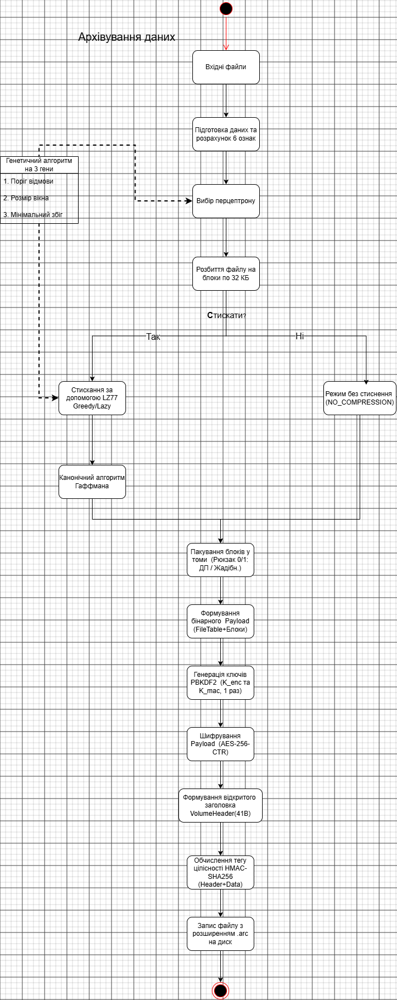
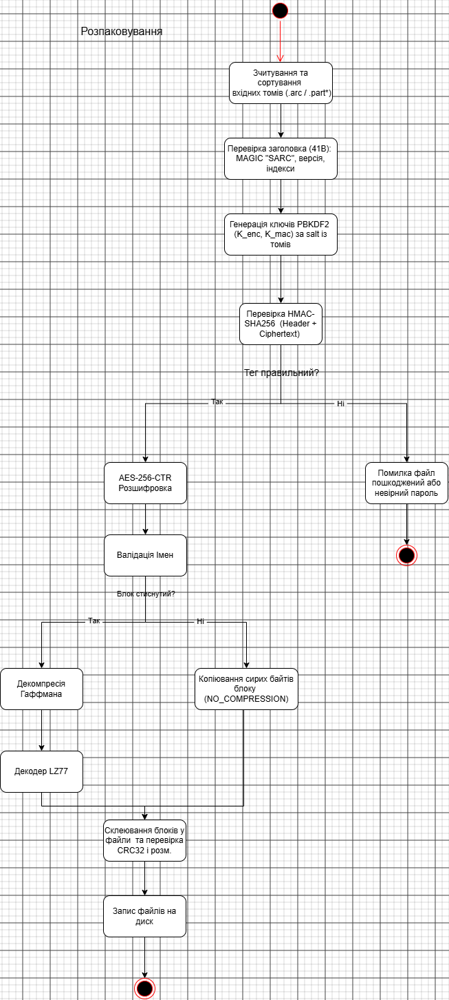

# Архітектура проєкту

Тут описується внутрішня структура системи, рух даних між модулями та контракти взаємодії для незалежної паралельної розробки чотирма учасниками команди.

---

## Процес архівування файлів

### Покроковий опис конвеєра створення архіву

1. **Збір вхідних файлів та вилучення ознак (`FeatureExtractor`)**  
   Архіватор отримує список шляхів до файлів, текстовий пароль користувача та ліміт розміру тому `max_volume_bytes` із конфігураційного файлу `team_config.json`. Для кожного файлу розраховується фіксований числовий вектор із 6 груп статистичних ознак (ентропія Шеннона по байтах, 32-кошикова гістограма, частка друкованих ASCII, середня відстань між символами кінця рядка `\n`, автокореляція на лагах 1..16 та ентропія біграм).

2. **Класифікація та вибір стратегії (`MLP Classifier`)**  
   Багатошаровий перцептрон класифікує файл на один із 7 типів (`0…6`) за вектором ознак і визначає базову стратегію обробки:
   * **`COMPRESS` (LZ77 + Гаффман):** призначається для тексту (`0`), вихідного коду (`1`), структурованих даних (`2`), растру без стиснення (`3`), виконуваних файлів (`4`) або штучних даних із низькою ентропією (`6`).
   * **`NO_COMPRESSION`:** призначається для вже стиснутих файлів (`5`: `.zip`, `.jpeg`, `.mp3`) та файлів із високою ентропією (випадковий шум у групі `6`), повторне стиснення яких не дає виграшу.

3. **Розбиття на блоки та стиснення (`BlockCompressor`)**  
   Файли нарізаються на блоки фіксованого розміру (`block_size` з `team_config.json`, за замовчуванням 32 КБ).  
   * Для блоків зі стисненням модуль **LZ77** (жадібний або лінивий розбір, вікно до 32768 байтів, довжина збігу `3…258`) виявляє повтори, а **канонічний Гаффман** будує три окремі дерева (`LIT` `0…256`, `LEN` `0…255`, `DIST` `0…15`) з обмеженням довжини коду до 15 біт і пакує потік MSB-first (розділ 3 `FORMAT_SPEC_P2.md`).
   * Якщо `allowCompression == false` або стиснутий блок вийшов не коротшим за сирий (`coded_len >= raw_len`), для блока автоматично виставляється прапорець `NO_COMPRESSION = 1` (`block_flags = 0x01`), а сирі байти зберігаються без змін (`coded_len = raw_len`).

4. **Оптимальне пакування блоків у томи (`Knapsack 0/1 DP`)**  
   Перед формуванням кожного тому фіксується множина всіх файлів, яким належать ще не розміщені блоки-кандидати, і таблиця цих файлів резервується в місткості тому:
   $$W = \text{max\_volume\_bytes} - 41 - 32 - 6 - \text{розмір\_таблиці\_файлів}$$
   Алгоритм рюкзака 0/1 на основі динамічного програмування ($O(n \cdot W)$) відбирає блоки з максимальною сумарною цінністю (пріоритетом типу файлу з `team_config.json`) при вазі блока $w = \text{coded\_len} + 15$ байтів. Блоки, які не помістилися, переходять до наступного тому, де множина кандидатів і таблиця файлів фіксуються заново.

5. **Формування структури Payload (`SarcFormatHandler`)**  
   Відібрані блоки та службові метадані об'єднуються в єдиний бінарний буфер (Payload) у суворому порядку без вирівнювань (розділ 2 `FORMAT_SPEC_P2.md`):
   * `file_count` (`uint16`, 2B), `flags` (`uint8`, 1B, для базового рівня `= 0`), `reserved` (`uint8`, 1B `= 0`).
   * **Таблиця файлів** (`file_count` записів): `name_len` (`uint16`), `name` (UTF-8, просте ім'я без шляху), `orig_size` (`uint32` всього файлу), `crc32` (`uint32` всього файлу), `file_type` (`uint8`, `0…6`), `strategy` (`uint8`).
   * `block_count` (`uint16`, 2B).
   * **Таблиця блоків** (`15 × block_count` байтів): `file_index` (`uint16`), `block_seq` (`uint32`), `raw_len` (`uint32`), `coded_len` (`uint32`), `block_flags` (`uint8`).
   * **Дані блоків**: склеєні підряд закодовані або сирі байти блоків.

6. **Формування криптографічних ключів (`PBKDF2 KDF`)**  
   Для нового архіву генерується 16 байтів випадкової солі (`salt`), спільної для всіх томів архіву. **Один раз на весь архів** за 100 000 ітерацій `PBKDF2-HMAC-SHA256` пароль розгортається у 64 байти, які діляться на два незалежні ключі:
   * $K_{\text{enc}} = \text{master}[0\dots 31]$ (32 байти) — ключ шифрування.
   * $K_{\text{mac}} = \text{master}[32\dots 63]$ (32 байти) — ключ автентифікації.

7. **Шифрування навантаження (`AES-256-CTR`)**  
   Для кожного тому формується унікальний 12-байтний `nonce` (рекомендована схема: `8 байтів префіксу архіву || uint32_BE(volume_index)`). Зібраний Payload шифрується алгоритмом `AES-256-CTR` із блоком лічильника `nonce (12B) || uint32_BE(i)`, де нумерація блоків $i$ починається з `1`.

8. **Автентифікація Encrypt-then-MAC (`HMAC-SHA256`)**  
   Обчислюється 32-байтний тег автентичності `HMAC-SHA256` ключем $K_{\text{mac}}$ над `volume[0 … 41 + ciphertext_len − 1]` (відкритий 41-байтний заголовок тому + шифротекст).

9. **Запис архіву на диск**  
   Формується фінальний бінарний файл тому довжиною `41 + ciphertext_len + 32` байтів:  
   `[VolumeHeader (41B)] + [Ciphertext] + [HMAC Tag (32B)]`.

---

## Процес деархівації файлів

### Покроковий опис конвеєра розпакування (розділ 4.3 `FORMAT_SPEC_P2.md`)

1. **Зчитування та первинна перевірка заголовків томів**  
   * Перевіряється довжина кожного тому $\ge 73$ байти (інакше відмова `E_SHORT`).
   * Зчитуються перші 41 байт у форматі Big-Endian: перевіряється `magic == "SARC"` та `version == 1` (інакше `E_MAGIC`).
   * Перевіряється точна відповідність фізичної довжини файлу значенню `41 + ciphertext_len + 32` (інакше `E_LENGTH`).
   * Перевіряється повнота і несуперечливість набору томів: узгодженість `volume_count` і `salt`, наявність усіх індексів `0 … volume_count − 1` без пропусків і дублікатів незалежно від порядку подання томів (інакше `E_VOLUMES`).

2. **Контроль цілісності та автентичності ДО розшифрування (`HMAC-SHA256`)**  
   Один раз на архів із пароля та `salt` через PBKDF2 обчислюються ключі $K_{\text{enc}}$ і $K_{\text{mac}}$. Для кожного тому обчислюється `HMAC-SHA256` над заголовком і шифротекстом та порівнюється з останніми 32 байтами тому **у постійний час** (`CryptographicOperations.FixedTimeEquals`):
   * **Ні:** процес негайно переривається з кодом `E_HMAC` **без спроби розшифрування** (принцип Fail-closed; невірний пароль також дає `E_HMAC`).
   * **Так:** автентичність підтверджена, перехід до розшифрування.

3. **Розшифрування вмісту (`AES-256-CTR`)**  
   За допомогою ключа $K_{\text{enc}}$ та `nonce` відповідного тому шифротекст розшифровується у бінарний Payload.

4. **Парсинг Payload та безпекова валідація (`E_PAYLOAD`)**  
   * Перевіряється `reserved == 0` та відсутність невідомих бітів у `flags` (при `flags != 0` у базовому форматі — `E_PAYLOAD`).
   * Для кожного запису таблиці файлів перевіряється `file_type <= 6` та **безпечність імені файла**: ім'я не порожнє, не `.` і не `..`, не містить `/`, `\`, `:`, нульового байта і не є абсолютним шляхом (інакше `E_PAYLOAD` до будь-якого запису на диск).
   * Перевіряються межі `file_index`, відсутність невідомих бітів у `block_flags` та точна відповідність довжини даних блоків сумі `coded_len`.

5. **Декомпресія блоків (`E_CODE`)**  
   Для кожного блоку читається біт 0 у `block_flags`:
   * Якщо `NO_COMPRESSION = 1`: перевіряється `coded_len == raw_len` і копіюються сирі байти.
   * Якщо `NO_COMPRESSION = 0`: перевіряються таблиці кодів `LIT` ($\le 256$), `LEN` ($\le 255$), `DIST` ($\le 15$), довжини кодів $1\dots 15$ та точна рівність Крафта ($\sum 2^{-L} = 1$ при `nsym > 1`). Потік декодується рівно на `token_count` елементів, після чого декодер LZ77 розгортає байти з контролем меж вікна та буфера (`E_CODE` при будь-якому порушенні).

6. **Склеювання файлів, перевірка `CRC32` (`E_CRC`) та атомарний запис**  
   * Блоки кожного файла з усіх томів упорядковуються за парою `(FileName, BlockSeq)`. Перевіряється, що `block_seq` утворюють суцільний ряд `0, 1, 2, …` без пропусків і повторів (інакше `E_PAYLOAD`).
   * Перевіряється збіг сумарної довжини з `orig_size` та обчисленого `CRC32` із записаним у таблиці файлів (інакше `E_CRC`).
   * Відновлені файли записуються на диск атомарно (через тимчасові файли з перейменуванням лише після повної верифікації всіх файлів архіву).
